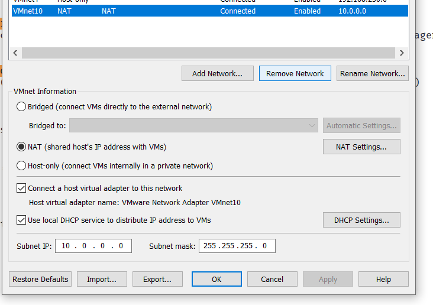

<div align="center">

# 🔐 Cybersecurity Lab Environment Setup

**Building an isolated virtual lab for penetration testing and ethical hacking practice**
</div>

<p align="center">
  
  
  
  
  
  
  
  
  
  
  
  
</p>

---

## 📌 Project Overview

This project focuses on setting up a **virtual cybersecurity and penetration-testing laboratory** using VMware Workstation and Kali Linux.

The purpose of the lab is to create a controlled environment where cybersecurity tools, network scanning, reconnaissance, vulnerability assessment, and other security-testing activities can be performed safely and repeatedly.

The lab is configured on a private virtual network so that additional machines can be added later and used as targets for authorized security testing.

---

## 🎯 Objectives

The main objectives of this project are to:

- Configure VMware Workstation virtual networking (VMnet custom NAT).
- Import and configure Kali Linux as a virtual machine.
- Create a private **NAT Network segment** (`10.0.0.0/24`) for the cybersecurity lab.
- Configure network connectivity for Kali Linux.
- Assign a consistent static IP address (`10.0.0.2`) to the Kali VM.
- Verify network connectivity, gateway access, and interface states.
- Document the complete setup process.
- Prepare the environment for future cybersecurity projects.

---

## 🛡️ Purpose of the Lab

The lab provides an isolated and controlled environment for cybersecurity learning and authorized security testing.

It can be used for activities such as:

- Network reconnaissance
- Port scanning
- Vulnerability assessment
- Packet analysis
- Web security testing
- Exploitation practice
- Security-tool experimentation

⚠️ **Important:** This laboratory must only be used for systems that you own or have explicit permission to test. Do not use the lab or its tools to attack unauthorized systems.

---

## 🏗️ Lab Architecture


Additional target machines can be added to the same virtual network in future projects.

---

## ⚙️ Lab Configuration

| 🧩 Component       | ⚙️ Configuration   |
| ------------------ | ------------------- |
| 🖥️ Host OS         | Windows             |
| 🧠 Host RAM        | 8 GB+               |
| ⚡ Hypervisor      | VMware Workstation  |
| 🐉 Security OS     | Kali Linux 2026.2   |
| 🧠 Kali RAM        | 2048 MB             |
| 🌐 Virtual Network | Custom NAT (VMnet10)|
| 📡 Network Address | 10.0.0.0/24         |
| 🐧 Kali IP Address | 10.0.0.2/24         |
| 🚪 Default Gateway | 10.0.0.1            |
| 🌍 DNS Server      | 8.8.8.8             |
| 🔮 Future VM Range | 10.0.0.3–10.0.0.99  |

---

# 🪜 Lab Setup Procedure

## Step 1. Hypervisor Setup (VMware Workstation)

VMware Workstation was selected as the virtualization platform to host the cybersecurity laboratory.

---

## Step 2. Create the Custom NAT Network

A dedicated custom NAT network segment (`VMnet10`) was configured in VMware Virtual Network Editor.

Configuration:
- **Network Name:** VMnet10 (NAT)
- **Subnet IP:** 10.0.0.0
- **Subnet Mask:** 255.255.255.0
- **DHCP:** Enabled



A **NAT Network segment** was chosen because virtual machines connected to it can communicate locally while routing outbound traffic securely through the host connection.

---

## Step 3. Import Kali Linux

Kali Linux was imported into VMware Workstation, and the virtual machine network adapter was assigned to the custom NAT network.

The VM network adapter was configured as follows:

```text
Network Connection: Custom: Specific virtual network -> VMnet10 (NAT)
